<p align="center">
  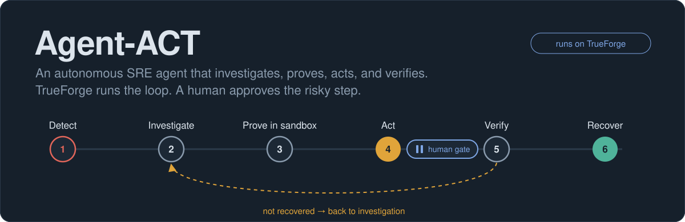
</p>

# ⚡ Agent-ACT: Autonomous SRE & Incident Response Agent

<p align="center">
  <b>An autonomous, production-grade SRE agent that runs on TrueForge.</b><br>
  It investigates live production incidents, proves root-cause hypotheses with self-authored diagnostic code in an isolated sandbox,<br>
  executes safe autonomous remediations, and halts at a strict human-in-the-loop gate before rolling back production.
</p>

<p align="center">
  <a href="https://github.com/Yug-dev0/Agent-ACT/actions/workflows/ci.yml"></a>
  <a href="https://github.com/Yug-dev0/Agent-ACT"></a>
  <a href="https://github.com/Yug-dev0/Agent-ACT"></a>
  
  
  
  
</p>

<p align="center">
  <a href="#-quickstart"><b>Quickstart</b></a> •
  <a href="#-key-workflows"><b>Workflows</b></a> •
  <a href="#-showcase"><b>Showcase</b></a> •
  <a href="#-system-architecture"><b>Architecture</b></a> •
  <a href="#-safety-boundaries--where-it-stops"><b>Safety Boundaries</b></a> •
  <a href="#-mcp-tools-catalog"><b>MCP Tools</b></a> •
  <a href="#-evaluation--testing"><b>Evaluation</b></a> •
  <a href="docs/README.md"><b>Documentation</b></a>
</p>

---

> 👨‍💻 **Maker & Author:** **Yug Patel** ([GitHub: @Yug-dev0](https://github.com/Yug-dev0) · ✉️ `yug.dev04@gmail.com`)  
> 🔗 **Repository:** [https://github.com/Yug-dev0/Agent-ACT](https://github.com/Yug-dev0/Agent-ACT)  
> 💡 *Monitoring tells you production broke. **Agent-ACT finds out why, mathematically proves it, acts safely, and objectively verifies that production actually recovered.***

---

## ⚡ In 30 Seconds

| Dimension | Description |
|---|---|
| **The Mission** | First response to a critical production incident: checkout error rate hits 100%, PostgreSQL connection pool saturates, alerts fire, and on-call needs rapid, safe triage and recovery. |
| **What Agent-ACT Does** | Reads alerts, metrics, structured logs, deployment history, and database pool state; **authors and runs isolated Python diagnostics in the TrueForge sandbox**; computes statistical correlations; attempts lowest-risk fixes; and **verifies recovery with multi-metric assertions**. |
| **Where it Stops** | **Before any production rollback.** TrueForge intercepts the call and presents an approval brief with blast radius and evidence to an on-call engineer. The server refuses to act without a single-use TrueForge session attestation. |
| **How it Proves Recovery** | `verify_recovery` enforces strict criteria: service readiness, 20 synthetic transactions through the public gateway, error rate < 5%, latency p95 < 1000ms, and DB connection load < 70%. |
| **Harness Architecture** | TrueForge handles all agent orchestration: LLM execution loop, tool dispatch, sandbox isolation, human-in-the-loop pauses, and immutable session logs. This repository contains **no hidden LLM client or homebrewed agent loop**. |

---

## 🔄 Key Workflows

### 1. End-to-End Incident Lifecycle Sequence

The following sequence illustrates the interaction between Prometheus monitoring, the TrueForge agent harness, the Agent-ACT MCP server, the isolated code sandbox, and the human reviewer.

```mermaid
sequenceDiagram
    autonumber
    actor Human as 👤 On-Call Engineer (Yug Patel)
    participant Monitor as 🚨 Prometheus / Alerts
    participant TF as 🏗️ TrueForge Agent Harness
    participant MCP as 🔌 Agent-ACT MCP Server (:18900)
    participant SBX as 📦 TrueForge Sandbox (Code Mode)
    participant Prod as 🐳 Demo Production Stack

    Note over Monitor,Prod: Incident Triggered: payment-service v2 deploys with connection leak
    Monitor->>Prod: Scrape metrics (error rate 100%, pool 92%)
    Monitor-->>Human: Alert: CheckoutErrorRateHigh & DatabaseConnectionsHigh
    Human->>TF: "Investigate checkout failure and recover production"
    
    TF->>MCP: get_incident_context()
    MCP-->>TF: Active alerts & entry signals (incident opened)
    
    TF->>MCP: Multi-signal query (health, metrics, logs, deployments, db_pool)
    MCP-->>TF: 14 metrics series, ERROR logs, deployment history
    
    Note over TF,SBX: Proving Root Cause in Sandbox
    TF->>SBX: exec: Write & run my_diag.py (calls collect_incident_evidence)
    SBX->>MCP: collect_incident_evidence(window=15)
    MCP-->>SBX: Aligned time series + log event totals
    SBX-->>TF: Evidence JSON (Pearson correlation = 0.94, v2 pool saturated)
    
    Note over TF,Prod: Step 1: Autonomous Low-Risk Remediation
    TF->>MCP: assess_action_risk(target="payment-service-v2", action="restart")
    MCP-->>TF: Risk: YELLOW (autonomous allowed, 8s disruption)
    TF->>MCP: restart_service(target="payment-service-v2")
    MCP->>Prod: Restart payment-service-v2 container
    MCP-->>TF: Container restarted and live
    
    Note over TF,Prod: Step 2: Objective Verification
    TF->>MCP: verify_recovery()
    MCP->>Prod: 20 synthetic checkouts + metric threshold check
    MCP-->>TF: Verdict: NOT_RECOVERED (pool re-saturates immediately)
    
    Note over TF,Human: Step 3: Escalation & Human-in-the-Loop Gate
    TF->>MCP: assess_action_risk(target="payment-service", action="rollback")
    MCP-->>TF: Risk: RED (approval required, target v1 ready)
    TF->>Human: ⏸️ TrueForge Native Gate: Prompt Approval Brief (v2 -> v1)
    
    alt Human Approves (Allow)
        Human->>TF: Click "Allow"
        TF->>MCP: rollback_deployment(service="payment-service", from="v2", to="v1")
        Note over MCP: Layer 2 Attestation: Validates human approval in TrueForge SQLite
        MCP->>Prod: Atomic traffic switch: gateway routes to v1; retire v2
        MCP-->>TF: Rollback successful (traffic switched to v1)
        TF->>MCP: verify_recovery()
        MCP->>Prod: Synthetic checkouts + metrics probe
        MCP-->>TF: Verdict: RECOVERED (0% errors, 50ms p95, 7% pool)
        TF->>MCP: generate_incident_report()
        MCP-->>TF: Audit-backed incident report generated (Markdown + JSON)
        TF-->>Human: ✅ Incident Resolved & Final Report Presented
    else Human Rejects (Deny)
        Human->>TF: Click "Deny"
        TF-->>MCP: Request never sent / Denied
        TF-->>Human: ⚠️ Rollback aborted; state UNRESOLVED; current blast radius reported
    end
```

---

### 2. Closed-Loop Decision Engine: Action ≠ Success

Agent-ACT is a true closed-loop controller. A command returning success does **not** equal an incident resolved:

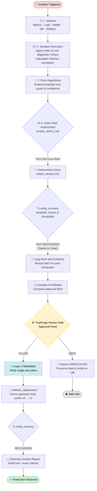

---

### 3. Two-Layer Safety & Human Approval Gate

To prevent rogue agent actions or accidental rollbacks, Agent-ACT employs defense-in-depth:

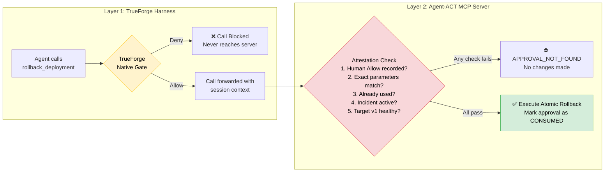

---

### 4. Sandbox Code-Mode Diagnostics Workflow

Agent-ACT does not guess root causes; it writes code in an isolated environment to prove them:

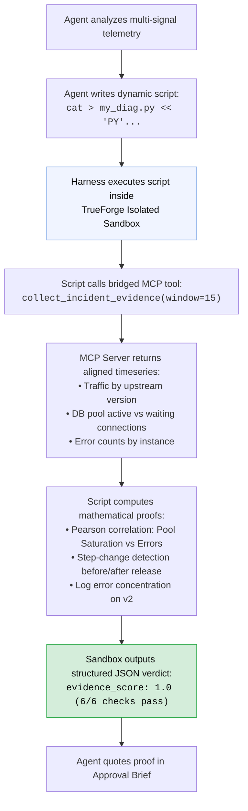

---

## 📸 Showcase

<p align="center">
  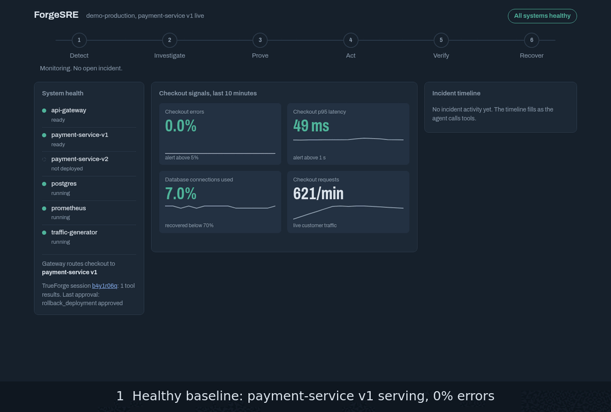
</p>

<table>
  <tr>
    <td width="50%" valign="top">
      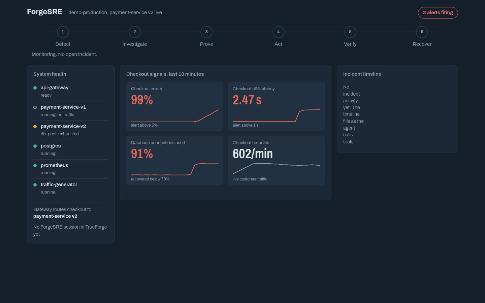<br>
      <b>1 · The Incident Occurs:</b> Release <code>v2</code> ships. Checkout error rate surges to 100%, p95 latency spikes to 2.5s, PostgreSQL connection pool hits 92% capacity, and 3 Prometheus alerts fire.
    </td>
    <td width="50%" valign="top">
      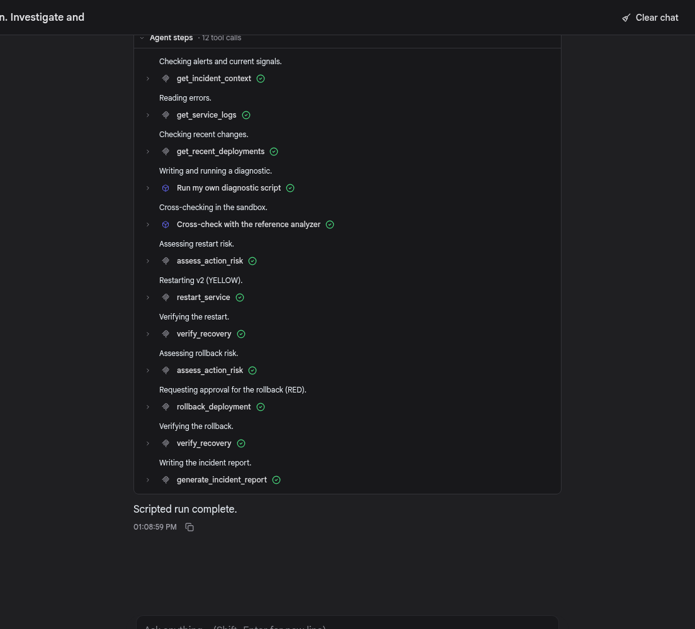<br>
      <b>2 · TrueForge Orchestrates Agent-ACT:</b> Every step is an authenticated MCP call. Two isolated sandbox execution steps prove root cause via self-written Python analysis.
    </td>
  </tr>
  <tr>
    <td width="50%" valign="top">
      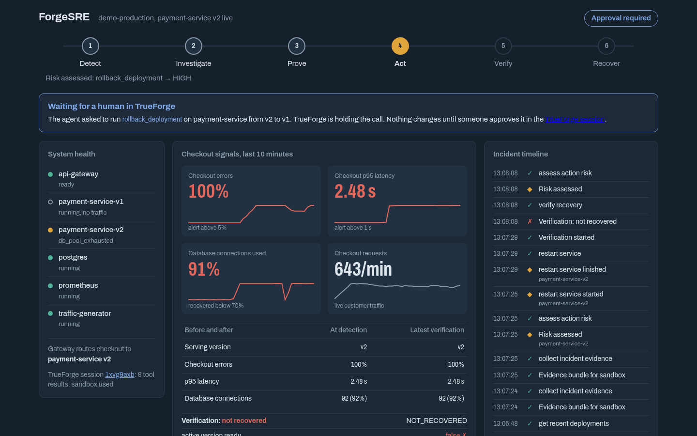<br>
      <b>3 · Closed Loop Detects Ineffective Restart:</b> A yellow service restart passes, but <code>verify_recovery</code> returns <code>NOT_RECOVERED</code>. Agent-ACT escalates to rollback.
    </td>
    <td width="50%" valign="top">
      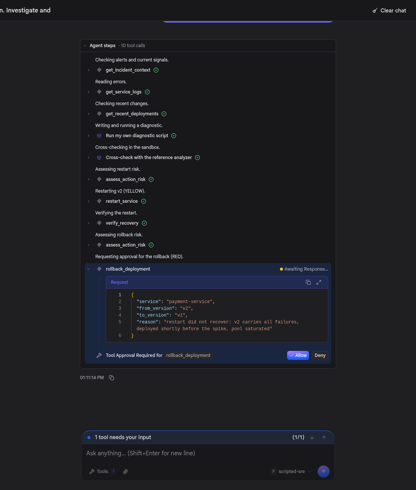<br>
      <b>4 · The Human Approval Gate:</b> TrueForge pauses execution. On-call engineer inspects the agent's approval brief, blast radius, and target readiness before clicking <b>Allow</b>.
    </td>
  </tr>
  <tr>
    <td width="50%" valign="top">
      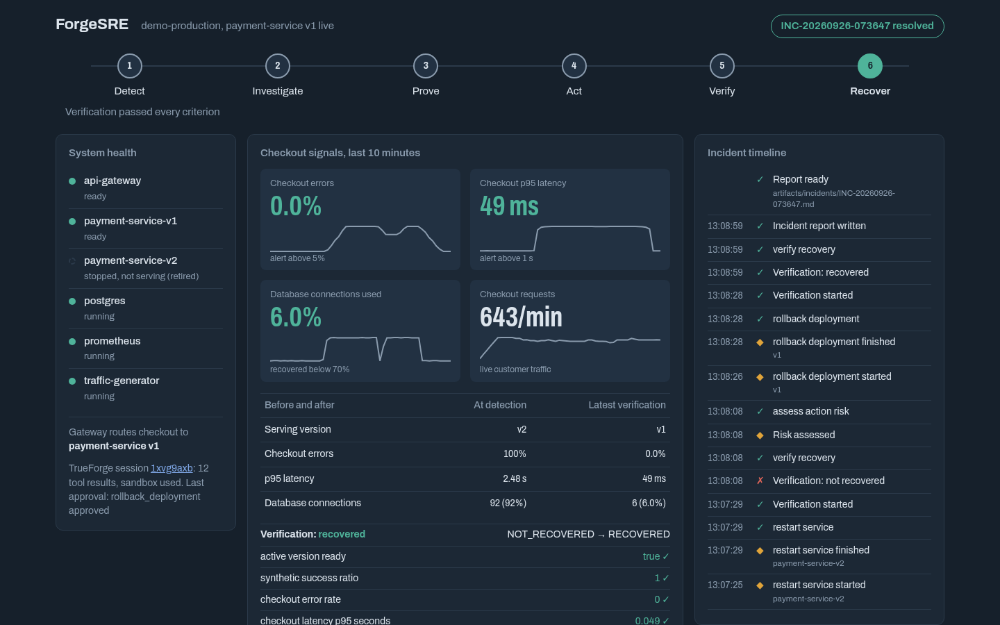<br>
      <b>5 · Verified System Recovery:</b> Traffic safely routes to <code>v1</code>. Error rate drops to 0%, latency normalizes to 50ms, DB connection load drops to 7%. Verification passes: <code>RECOVERED</code>.
    </td>
    <td width="50%" valign="top">
      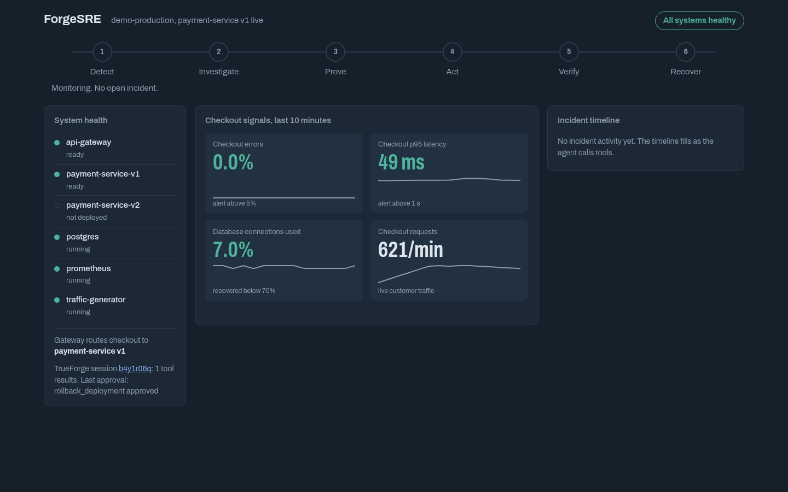<br>
      <b>6 · Deterministic Baseline Reset:</b> Running <code>./scripts/reset-demo.sh</code> restores the environment to a verified healthy state in under 60 seconds.
    </td>
  </tr>
</table>

<sub>Live session artifacts captured by <code>scripts/dev/capture_showcase.py</code>. View generated incident reports: <a href="artifacts/incidents/example-contract-test-approved.md"><b>Approved Run Report</b></a> · <a href="artifacts/incidents/example-contract-test-denied.md"><b>Denied Run Report</b></a>.</sub>

---

## 🛡️ Safety Boundaries: Where It Stops

Agent-ACT enforces a strict four-tier classification policy defined in [`config/policy.yaml`](config/policy.yaml):

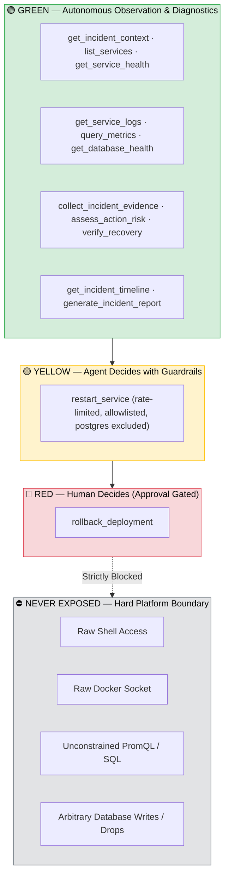

### Risk Classification Matrix

| Risk Tier | Tools | Authority | Policy & Enforcement |
|:---|:---|:---|:---|
| 🟢 **GREEN** | `get_incident_context`, `list_services`, `get_service_health`, `get_service_logs`, `query_metrics`, `get_database_health`, `get_recent_deployments`, `get_active_deployment`, `collect_incident_evidence`, `get_reference_analyzer`, `assess_action_risk`, `get_incident_timeline`, `run_synthetic_check`, `verify_recovery`, `generate_incident_report` | **Agent** | Read-only observation, synthetic probes, bounded log queries, and diagnostic analysis. No state changes. |
| 🟡 **YELLOW** | `restart_service` | **Agent with Guardrails** | Autonomous execution permitted **only** if `assess_action_risk` validates no blockers. Enforced allowlist, max 2 restarts per 10 min window per target; stateful DB (`postgres`) is strictly forbidden. |
| 🔴 **RED** | `rollback_deployment` | **Human-in-the-Loop** | **TrueForge UI approval gate** pauses call. MCP server validates cryptographic attestation from TrueForge session record, confirms target readiness, and invalidates token upon execution (no replays). |
| ⛔ **NEVER** | Shell, arbitrary Docker commands, raw SQL, raw PromQL, DELETE/DROP queries | **Nobody** | Not exposed in the MCP tool schema. |

---

## 🧰 MCP Tools Catalog

Agent-ACT exposes **17 specialized, validated, bounded MCP tools** via Streamable HTTP (`:18900`):

<details open>
<summary><b>Click to view all 17 tools</b></summary>

| Tool Name | Class | Description |
|---|:---:|---|
| `get_incident_context` | 🟢 GREEN | Returns active firing alerts and baseline entry signals; formally initializes the incident tracking record. |
| `list_services` | 🟢 GREEN | Lists discovered microservices, containers, current release versions, and runtime health status. |
| `get_service_health` | 🟢 GREEN | Inspects container lifecycle, restart counts, `/health` and `/ready` HTTP probes, and active endpoints. |
| `get_service_logs` | 🟢 GREEN | Bounded, structured JSON logs filtered by service, level, and timeframe with event frequency counts. |
| `query_metrics` | 🟢 GREEN | Queries 14 pre-defined Prometheus telemetry signals (prevents arbitrary PromQL injection). |
| `get_database_health` | 🟢 GREEN | Queries PostgreSQL connection states (`active`, `idle`, `idle in transaction`) and pool exhaustion levels. |
| `get_recent_deployments` | 🟢 GREEN | Returns structured deployment log with timestamps, release tags, and author commit history. |
| `get_active_deployment` | 🟢 GREEN | Queries the live traffic routing state currently configured at `api-gateway`. |
| `collect_incident_evidence`| 🟢 GREEN | Prepares multi-signal aligned timeseries and log summaries formatted specifically for sandbox ingestion. |
| `get_reference_analyzer` | 🟢 GREEN | Delivers reference statistical diagnostic code into the isolated sandbox over the MCP bridge. |
| `assess_action_risk` | 🟢 GREEN | Computes deterministic blast radius: dependency graph, current RPS, target readiness, and blockers. |
| `get_incident_timeline` | 🟢 GREEN | Retrieves full audit log of all events, queries, tool calls, and transitions for the active incident. |
| `run_synthetic_check` | 🔍 Probe | Fires tagged synthetic checkout transactions through `api-gateway` to assess live customer experience. |
| `verify_recovery` | 🔍 Probe | Evaluates post-remediation health against five multi-metric thresholds specified in `config/verification.yaml`. |
| `restart_service` | 🟡 YELLOW | Restarts an allowlisted container and polls readiness health probes until live. |
| `rollback_deployment` | 🔴 RED | Two-layer approval gated, attested atomic traffic switch reverting gateway routing to a healthy release. |
| `generate_incident_report`| 📄 Report | Generates structured Markdown and JSON post-mortem reports backed by immutable audit log numbers. |

</details>

---

## 🏗️ System Architecture

```mermaid
flowchart TB
    subgraph Harness["🏗️ TrueForge Agent Harness (Local Standalone / Daytona)"]
        UI["🖥️ TrueForge Web UI (:8790)"]
        ENGINE["🔄 Agent Execution Engine"]
        GATEWAY["⏸️ Native Approval Gate"]
        SANDBOX["📦 Isolated Sandbox (Bubblewrap / Daytona)"]
        SQLITE[("💾 TrueForge SQLite Storage")]
        
        UI <--> ENGINE
        ENGINE --> GATEWAY
        ENGINE --> SANDBOX
        ENGINE <--> SQLITE
    end

    subgraph Server["🔌 Agent-ACT MCP Server (:18900)"]
        DISPATCH["Tool Dispatcher (17 Tools)"]
        POL["Policy & Risk Engine (config/*.yaml)"]
        ATTEST["Attestation Verifier"]
        AUDIT[("Audit Log (events.jsonl)")]
        DASH["Mission Control Dashboard"]
        
        DISPATCH --> POL
        DISPATCH --> ATTEST
        DISPATCH --> AUDIT
    end

    subgraph Production["🐳 Demo Production Environment (Docker Compose)"]
        GW["🌐 api-gateway (:18080)"]
        PV1["💳 payment-service v1 (stable)"]
        PV2["💳 payment-service v2 (leaks pool)"]
        DB[("🐘 PostgreSQL (:15432)")]
        PROM["📊 Prometheus (:19090)"]
        TRAF["🤖 Traffic Generator (10 RPS)"]
        
        GW -->|Active Route| PV1
        GW -.->|Incident Route| PV2
        PV1 --> DB
        PV2 --> DB
        PROM --> GW & PV1 & PV2 & DB
        TRAF --> GW
    end

    ENGINE <-->|Streamable HTTP /mcp (Bearer Token)| DISPATCH
    SANDBOX <-->|Bridged mcp_client| DISPATCH
    ATTEST <-->|Verify Turn Approval| SQLITE
    DISPATCH <-->|Docker API / HTTP Probes / SQL| Production
```

### The Incident Bug Anatomy

Why does production fail?
1. **Release `v2` Deployed:** `payment-service-v2` ships with an audit logging enhancement.
2. **Defect:** Audit logs are batched in transactions of size 100 (`batch_size=100`), but PostgreSQL pool size is capped at 85 (`max_connections=85`).
3. **Connection Starvation:** Transactions never reach the commit batch threshold, leaving connections stuck in `idle in transaction`.
4. **Cascade:** Within 15 seconds, all available connections are exhausted. Checkout transactions fail with HTTP 500, error rates reach 100%, and latency skyrockets.
5. **Why Restart Fails:** Restarting `payment-service-v2` temporarily releases connections, but incoming traffic immediately strands them again. The defect is in the code. Only an attested rollback restores stability.

---

## 🚀 Quickstart

### Prerequisites

| Requirement | Recommended Version | Purpose |
|:---|:---|:---|
| 🐳 Docker & Docker Compose | v2.20+ | Production microservices stack |
| 📦 Node.js | ≥ 22.14 | TrueForge agent harness runtime |
| 🐍 [uv](https://docs.astral.sh/uv/) | Latest | Fast Python package management |
| 🔑 Model API Key | TrueFoundry, OpenAI, Anthropic, or Gemini | Agent LLM provider |

> **OS Compatibility:** Tested on macOS and Linux (Ubuntu / Fedora). Windows users should run via WSL2.

---

### Step 1 — Clone & Bootstrap

```bash
# Clone the repository
git clone https://github.com/Yug-dev0/Agent-ACT.git agent-act
cd agent-act

# Run the automated setup wizard (verifies environment, generates secrets, builds containers)
./scripts/setup.sh
```

---

### Step 2 — Configure Model Credentials

Edit your `.env` file (generated by `setup.sh`):

```bash
# Recommended: TrueFoundry AI Gateway
MODEL_PROVIDER=truefoundry
MODEL_ID=openai-polaris/gpt-4.1-mini
MODEL_API_KEY=<your-truefoundry-jwt-token>
MODEL_BASE_URL=https://gateway.truefoundry.ai

# Alternative: Direct OpenAI
# MODEL_PROVIDER=openai
# MODEL_ID=gpt-5.4-mini
# MODEL_API_KEY=sk-...
```

---

### Step 3 — Bring Up the System

```bash
# Starts Docker containers, MCP server, TrueForge harness, and registers the agent
./scripts/up.sh

# Run health diagnostics to confirm everything is green
./scripts/doctor.sh
```

Once running, access the dashboards:
- 🏗️ **TrueForge Agent Interface:** [http://localhost:8790](http://localhost:8790) (Agents → `forgesre` → Try)
- 📊 **Agent-ACT Mission Control:** [http://127.0.0.1:18900/dashboard](http://127.0.0.1:18900/dashboard)
- 📈 **Prometheus Metrics:** [http://127.0.0.1:19090](http://127.0.0.1:19090)

---

### Step 4 — Trigger the Live Incident

Simulate the release of the defective `payment-service v2`:

```bash
./scripts/trigger-incident.sh
./scripts/verify-incident.sh    # Waits until Prometheus alerts fire (~20s)
```

---

### Step 5 — Run Agent-ACT

In the TrueForge UI (or by running `./scripts/run-agent.sh` in your terminal), submit the prompt:

```text
Production checkout failures are being reported. Investigate the incident, determine the root cause,
take safe recovery actions, and restore the system.
```

1. **Watch Investigation:** The agent checks alerts, logs, metrics, and database pool status.
2. **Observe Code Execution:** The agent writes and executes Python in the isolated sandbox.
3. **See Closed-Loop Restart:** The agent tests a service restart, verifies recovery, and observes that the failure persists.
4. **Approve Rollback:** TrueForge pauses and displays the **Tool Approval Required** panel. Review the approval brief and click **Allow**.
5. **View Recovery:** Traffic immediately switches to `v1`, metrics recover to baseline, and a post-mortem report is saved to `artifacts/incidents/`.

---

### Step 6 — Reset Baseline

Restore the system to a clean, verified healthy baseline at any time:

```bash
./scripts/reset-demo.sh
```

---

## 🧪 Evaluation & Testing

Agent-ACT includes a comprehensive test suite covering safety rules, tool execution, Docker integration, and model evaluations:

| Test Suite | Command | Result | Coverage |
|---|---|:---:|---|
| **Unit Tests** | `cd mcp-server && uv run pytest` | **63 Passed** | Input validation, risk policies, token safety, report generation, replay defense |
| **Live Integration** | `cd mcp-server && uv run pytest -m integration` | **12 Passed** | Live Docker stack: incident trigger, restart failure, atomic rollback, recovery |
| **TrueForge Lifecycle** | `uv run pytest -k test_trueforge_lifecycle` | **Passed** | Full harness routing: 12 tool calls, sandbox runs, gate pause, attestation |
| **Model Evaluation** | `./scripts/eval.sh --scenario approve --runs 1` | **100/100** | End-to-end evaluation with live LLM (sandbox code generation, brief, recovery) |

Run automated evaluations:
```bash
./scripts/eval.sh             # Scored runs: approve, deny, and false alarm scenarios
./scripts/rehearse.sh 3       # 3 guided rehearsal runs with real model
./scripts/rehearse.sh --scripted  # Test full UI & approval gate without an API key
```

---

## 📁 Repository Map

```text
agent-act/
├── agent/                       # TrueForge agent configurations & prompt instructions
│   ├── forgesre.system.md       # Full closed-loop SRE agent system prompt
│   ├── forgesre-investigator.system.md # Read-only investigator prompt
│   ├── setup.md                 # Manual TrueForge configuration guide
│   └── demo-prompts.md          # Sample demo prompts and follow-up queries
├── config/                      # Declarative operational policies (YAML)
│   ├── policy.yaml              # Tool risk tiers (GREEN, YELLOW, RED) & allowlists
│   ├── services.yaml            # Microservices catalog, ports, and health endpoints
│   ├── verification.yaml        # Post-incident recovery assertion thresholds
│   └── incidents.yaml           # Incident simulation definitions
├── demo/                        # Production microservices stack (Docker Compose)
│   ├── gateway/                 # Public reverse proxy & dynamic routing engine
│   ├── payment-v1/              # Stable payment processing service (psycopg pool)
│   ├── payment-v2/              # Defective service (batch audit connection leak)
│   ├── database/                # PostgreSQL init scripts & monitor role
│   ├── prometheus/              # Prometheus scrapers & incident alert rules
│   └── traffic-generator/       # Continuous background traffic generator (10 RPS)
├── mcp-server/                  # Agent-ACT MCP Server implementation (Python)
│   ├── src/forgesre/            # Server, tools, Docker controller, attestation, ops
│   └── tests/                   # 63 unit & 12 integration tests
├── skills/                      # TrueForge Skills
│   └── incident-diagnostics/    # Statistical analyzer skill for the sandbox
├── scripts/                     # Operational automation scripts
│   ├── setup.sh                 # Environment setup and credential generation
│   ├── up.sh                    # Full system bootstrap
│   ├── doctor.sh                # System diagnostics & troubleshooting checker
│   ├── trigger-incident.sh      # Injects production defect
│   ├── reset-demo.sh            # Restores healthy baseline
│   ├── run-agent.sh             # Terminal driver for TrueForge agent
│   └── eval.sh                  # Quantitative evaluation runner
├── artifacts/                   # Audit logs, evaluation scorecards, and incident reports
└── docs/                        # In-depth architectural & technical documentation
```

---

## 📖 Documentation Index

| Guide | Description |
|---|---|
| [🏗️ **Full Architecture**](docs/architecture.md) | Deep dive into system design, components, sandbox architecture, and two-layer security. |
| [🧭 **Implementation & Learnings**](docs/implementation.md) | Problem statement, technical challenges overcome, and design decisions. |
| [⚖️ **Judging Map**](docs/judging-map.md) | Direct mapping of hackathon criteria to code evidence and demo demonstrations. |
| [🎬 **Demo Runbook**](docs/demo.md) | Step-by-step 5-minute presentation script and visual checklist. |
| [🎥 **Video Script**](docs/video-script.md) | 3-minute timed narration plan for video submissions. |
| [📣 **Public Build Story**](docs/build-story.md) | Summary narrative for LinkedIn / X community showcases. |
| [🗺️ **Repository Deep Dive**](docs/map.md) | Comprehensive line-by-line file breakdown and request tracer. |

---

## 🤖 AI Assistance Disclosure

In accordance with hackathon guidelines, this project was developed with the assistance of an AI coding assistant (Claude Code), utilized under the direct supervision, architectural direction, and engineering design of the author, **Yug Patel**. All design choices, policy models, two-layer attestation mechanisms, microservice failure topologies, and test suites were engineered, verified, and validated by Yug Patel.

---

## 👤 Maker & Author

**Yug Patel**  
- **GitHub:** [@Yug-dev0](https://github.com/Yug-dev0)  
- **Email:** [yug.dev04@gmail.com](mailto:yug.dev04@gmail.com)  
- **Repository:** [https://github.com/Yug-dev0/Agent-ACT](https://github.com/Yug-dev0/Agent-ACT)  
- **Project:** Agent-ACT (Autonomous Incident Response & SRE Agent)

---

## 📄 License

This project is licensed under the MIT License - see the LICENSE file for details.
